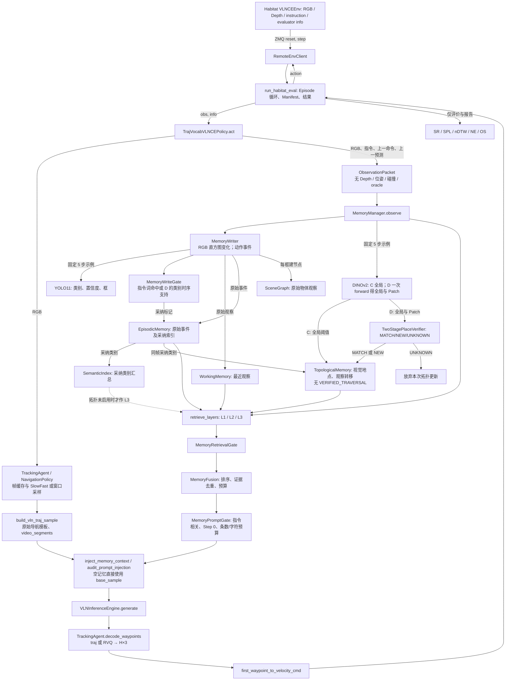
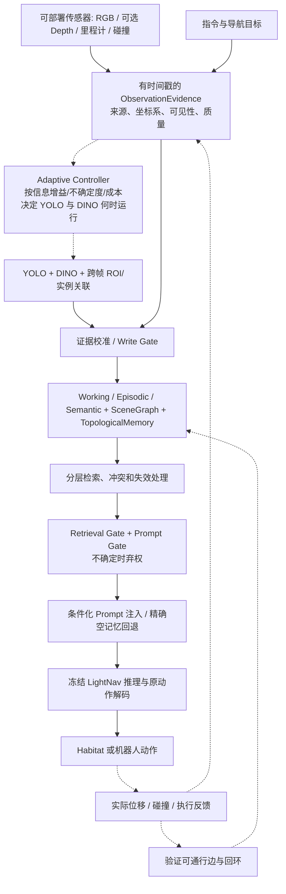

# RGM-LightNav Agent 架构：现状与目标

> 源码快照：2026-11-10，本地 `codex-adaptive-memory`，HEAD `0b960a8` 加当前未提交工作树。本文描述的 RGM V1 主要还没有进入 HEAD。以工作树代码为准；目标图不代表已实现。详细证据见 [项目交接](AGENT_PROJECT_HANDOFF.md)。

## A. 当前代码实际运行的架构

入口分别是 `src/lightnav/habitat/runner.py:687`、`src/lightnav/habitat/policy.py:216` 和 `src/lightnav/memory/manager.py:148`。`runner` 把 `info` 传给 Policy，但 Policy 的记忆包构造明确排除了它（`policy.py:229-239`）；`info` 的成功率、距离等只在 `runner.py:969-1024` 用于评价。`VLNCEEnv` 自身可能在观测中附带 `goal_distance` 和 `progress`（`habitat_server/lightnav_habitat/vlnce.py:102-110,562-563`），Policy 也没有把它们送进 Agent。

**实际开关路径。** A 关闭记忆，Policy 调用 `engine.generate_from_frames`（`policy.py:411-422`）；C/D 开启记忆，先构建同一基础 sample，再有条件地添加文本，调用 `engine.generate`（`policy.py:241-272,406-410`）。两条路径共用 `TrackingAgent.decode_waypoints` 和速度映射（`policy.py:435-473`）。C 的三个 Gate 开启，但 YOLO 时序、DINO 两阶段和拓扑运动验证关闭；D 在 C 上开启这三项（`scripts/run_rgm_pilot_88.sh:118-169`）。三组不是三套模型。

## 数据契约与证据等级

| 结构 | 实际字段及形状 | 能证明什么 | 不能证明什么 |
|---|---|---|---|
| Habitat `obs` | `rgb: H×W×3 uint8`，`depth: H×W float32`，`instruction`；另有 `goal_distance/progress` | 环境可提供这些字段 | RGM 当前会使用 Depth 或目标距离 |
| `ObservationPacket` | `step_id:int`、瞬时 RGB、`instruction:str`、上一轮动作 `dict`、上一轮模型文本 `str?`；`to_dict` 不序列化 RGB（`schemas.py:187-205`） | 当前图像与命令历史 | Agent Pose、碰撞、真实位移、oracle 成功 |
| `DetectedObject` / `RGMEvidence` | 类别、检测分数、`xyxy`；Episode/step/event/source/provenance（`schemas.py:208-267`） | 某帧的类别候选 | 同一物体实例、房间身份 |
| `VisualPlaceFeatures` | 384 维 L2 全局描述子；D 组有采样 `N×384 float16` Patch、处理后网格和索引（`schemas.py:271-277`） | 视觉外观相似及局部几何一致性 | 相机世界坐标、真实回环或通行 |
| `PlaceDecision` | `MATCH/NEW/UNKNOWN`，候选地点、全局相似度、局部匹配/内点（`schemas.py:280-288`） | 满足 V1 视觉门槛的地点假设 | SLAM 意义的闭环验证 |
| `PlaceEdge` | 两个视觉地点、命令事件 ID、前后描述子 ID（`topological_memory.py:112-132,304-335`） | 带有命令代理的观察转移 | `VERIFIED_TRAVERSAL`；目前没有此证据 |

当前 RGB 直方图差为颜色变化代理；`MemoryWriter` 以 `0.45/0.65` 标记变化（`memory_writer.py:98-145,312-329`）。亮度、转头、遮挡也会改变直方图。D 的边还要求前向命令代理及视觉差至少 `0.35`（`manager.py:359-390`），但动作中的 `linear_velocity` 是归一化控制值（`velocity.py:44-55`）；`>0` 不是已标定的实际前移，更不是实际位移。

## 机制边界

1. **没有运行中的 Adaptive Controller。** `RGMConfig.adaptive_extraction_enabled=True` 会直接报错（`rgm_config.py:18,38-40`）。YOLO 用 `step % every_n_steps == 0`（`yolo_scene_extractor.py:81-88`），DINO 同样固定取样（`manager.py:179-187`）。现阶段不能声称通过自适应调度减少模型调用。
2. **Object Association 是类别级时序共识。** 同类在最近 3 次成功检测中至少 2 个不同步长出现；成功的空检测会推进窗口（`object_association.py:21-57`）。`instance_match` 静态函数要求 ROI 和运动对应，但没有接入实际 Pipeline（同文件 `:59-91`）。没有跨帧实例轨迹。
3. **SceneGraph 与 TopologicalMemory 是两套图。** 前者对 YOLO 每个框建原始物体节点；YOLO 不输出房间标签，因此不能把其物体节点当作已识别地点。后者以 DINO 视觉描述子建地点节点，仅在地点不同且有命令证据时建 `observed_transition`；D 的 `UNKNOWN` 不更新图（`manager.py:374-385`）。
4. **检索有独立拒绝阶段。** Write Gate 把原始事件保留供审计，但只索引采纳事件；Retrieval Gate 排除无来源、未采纳、指令无关及未验证空间断言；Prompt Gate 只放可溯源且与指令词匹配的视觉类别，最多 3 条、400 字符（`manager.py:200-228`；`memory_retrieval_gate.py:21-81`；`memory_prompt_gate.py:21-79`）。这不是学习得到的置信度校准或完整冲突求解。
5. **模型输入有回退契约。** 无有效记忆时传原 `base_sample`，Step 0 只可能加入当前高分、指令相关类别；不会无条件注入首次地点编号。注入位置在 `</navigation_task>` 之后，审计要求原 Prompt 可逐字恢复、视频对象同一引用（`policy.py:253-272`；`memory_context_builder.py:52-140`）。

## B. 研究目标架构（尚未实现的部分以虚线标出）

虚线对应目标依赖或目前缺失的证据通道，尤其是可部署的位姿/运动反馈、跨帧实例关联、真正自适应的视觉推理调度、可校准的证据强度、冲突与过时记忆处理。目标实现仍应保持 LightNav 视觉采样、原导航模板、模型权重、RVQ/轨迹解码和动作接口不变；研究变量集中在可审计记忆决策层。目标中的 Depth 仅在确认真实部署可获得、且不会读取 evaluator oracle 后才能启用。
