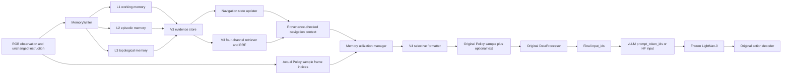

# RGM V4: source mapping and implementation record

## Phase 0: source audit and Paper-to-Code mapping

V4 uses the frozen LightNav-0 checkpoint, original action decoder, original RGB
history and original chat template. It reuses the V3 evidence store and four-channel
RRF retriever. The two reference projects inform state organization only; no code
is copied from either project.

| Reference implementation | Source behavior | V4 adaptation | Deliberately excluded |
| --- | --- | --- | --- |
| Three-Step Nav `prompts.py`: `ACTION_DETECTION`, `LANDMARK_DETECTION` | Prompts ask an LLM to split instructions and extract landmarks. | Match observed labels to terms in the unchanged instruction; retain unresolved anchors. | Extra LLM calls and rewritten instructions. |
| Three-Step Nav `spatialNavigator.py`: `save_history`, `review_history` | Summarizes an observed view and a thought, then serializes a step sequence; its driver can call `save_history` before `env.step`. | Keep evidence-qualified Episode/Step history; distinguish observation from a commanded action. | GPT summaries, candidate viewpoint IDs, and thought text as fact or verified motion. |
| Three-Step Nav `spatialNavigator.py`: `estimate_completion` | Defines an LLM completion request but is not called by the pinned driver; the active path parses `Completion Estimation:` from the navigator response. | Express observed/progress-unknown states from stored evidence; never promote a sighting or command to completed travel. | LLM completion decision. The standalone `COMPLETION_ESTIMATION` prompt in `prompts.py` is commented out in the audited source. |
| Three-Step Nav `decision_agent.py`: `NavigationDecision`; `navigation_capabilities.py`: four capability functions | Defines Continue, Stay, Backtrack, Look Around and mutating responses. | Use the idea that memory is useful under different navigation conditions, represented as context-use modes. | Executing any of those actions, automatic backtracking/stopping, random fallback and external APIs. |
| MapGPT `GPT/one_stage_prompt_manager.py`: `make_history` | Records chosen actions by step. | Preserve `ISSUED` as an action provenance category, separate from observed movement. | Treating a choice as physical traversal. |
| MapGPT `make_map_prompt` | Separates trajectory nodes from other observed but unvisited nodes. | Keep visited versus merely observed places distinct; preserve unknown traversability. | Discrete graph IDs as LightNav actions. |
| MapGPT `make_r2r_prompts`, `parse_planning` | Assigns roles to Instruction, History, Trajectory, Map, Supplementary Info and Previous Planning. Its implementation still includes Supplementary Info on every step although its description limits use to error/backtracking. | Add only instruction-relevant historical facts when a state-dependent use mode calls for them. | GPT planning output and unconditional supplementary material. |

Source identity: [Three-Step Nav](https://github.com/ZoeyZheng0/ThreeStepNav)
`main` at `5cdbdcff356cda301e23496c5d850c15b2433d87` (MIT `LICENSE`);
the requested `.references/3-step-Nav/` directory is absent from this workspace,
so the four specified files were reviewed from the public repository at this
revision. [MapGPT](https://github.com/chen-judge/MapGPT) local `main` at
`7c642f4507a8dde6703e2c61c8fd8ff3bc4bd322` has no LICENSE or COPYING file
in the checked-out tree; its source was read, not copied.

LightNav input audit: `TrackingAgent.observe` assigns absolute frame IDs and its
windowed buffer preserves chronological order; SlowFast retains the full Episode
buffer and `slowfast_video_segments` samples sparse tiers. The sample carries
the actual per-segment `frame_indices`. `Qwen3VLDataProcessor._build_messages`
splits only the human message on literal `<video>` placeholders, then sends
the unchanged video segments through the checkpoint processor. The existing
insertion point immediately after `</navigation_task>` is therefore reusable
with escaped memory text. A memory observation counts as already visible in the
RGB input only when the Episode identity and its Step-to-frame-ID mapping are
known and that frame ID occurs in the current sample. Uncertain mappings are
never treated as proof of visual duplication.

## V4 implementation

The existing L1 store still records recent observations, L2 preserves Episode
events and their time order, and L3 preserves place and spatial hypotheses.
V4 does not add a new database or train a policy. The V3 evidence store and
four-channel retriever remain the authoritative source for candidate records;
V4 checks the original `EvidenceRecord` behind each retrieved summary.

### Navigation state and evidence classes

`NavigationState` records the original instruction, lexical instruction
anchors, active anchor, anchor evidence and status, recent observation IDs,
historical landmark IDs, revisit candidates, repeated-observation count,
progress status, uncertainty, canonical evidence IDs and provenance, and the
last update Step. Scene, Episode and rollout identity are explicit. The updater
reads only the V3 store after the current observation has been persisted.

Progress labels are `NOT_OBSERVED`, `OBSERVED`, `POSSIBLE_REVISIT`,
`PROGRESS_SUPPORTED`, and `COMPLETION_UNKNOWN`. The first two apply to anchor
evidence; the overall progress state uses the latter three or `OBSERVED`.
An object sighting can establish `OBSERVED`, never instruction completion. A
positive velocity command remains `ISSUED` and cannot establish passage.
`PROGRESS_SUPPORTED` requires a V3 `verified_traversal` linked to an
instruction-relevant current landmark and an independently measured
displacement record. The current Habitat client supplies no such measurement,
so ordinary online runs should keep passage and completion unknown.

DINO descriptors compare current and earlier observations in the same Scene.
A revisit candidate needs distinct historical observation times and an
instruction link to qualify for prompt use. Even then, its identity remains
`unknown` and the state can only say `POSSIBLE_REVISIT`. V4 neither invents
coordinates nor turns visual similarity into a verified place link.
Online descriptors require the existing configured DINO place extractor;
without it, revisit mode remains inactive while the other modes still work.

### Context and use decisions

`build_navigation_memory_context` expands V3 retrieved candidates into atomic
facts with canonical Evidence IDs, Scene/Episode/rollout/Step provenance,
`CURRENT` or `HISTORICAL` role, observation status, visit status and
traversability status. It separately returns historical landmarks, possible
revisits, verified progress, uncertain relations and issued commands. A
`place_visit` extractor label is explicitly rendered as an observed place
hypothesis with visit `UNKNOWN`. Conflicting source descriptions remain
distinct facts, and the same Evidence ID is added only once.

The utilization manager chooses the first useful mode in this order:

| Mode | Evidence required | Text offered to LightNav |
| --- | --- | --- |
| `REVISIT_AUDIT` | Instruction-related current visual match to at least two independent historical observations in the same Scene | Possible revisit, current and historical sources, identity `UNKNOWN` |
| `PROGRESS_AUDIT` | Linked measured traversal, or an instruction about passage with a relevant historical observation | Measured motion or earlier sighting, with completion and unverified passage marked `UNKNOWN` |
| `HISTORY_REFERENCE` | Relevant historical landmark or source-bound uncertain spatial relation | Compact observation or relation with its uncertainty |
| `NONE` | No useful or fitting history, or unchanged prior context | No memory text; the exact original sample object is used |

Visual duplication requires an exact Scene/Episode/rollout/Step-to-frame-ID
mapping and membership in the Policy sample's `video_segments[*].frame_indices`.
Step distance, descriptor similarity and a time gap alone never prove that a
past observation is already in LightNav's RGB input. A repeated revisit with
the same historical support is suppressed even when each current RGB gets a
new Evidence ID. If a complete revisit statement cannot fit, the manager
tries relevant historical facts. The manager never emits an action.

### Prompt and token contract

The V4 formatter writes at most three complete statements and 400 escaped
characters by default. It skips an oversized statement and tries the next
candidate. Each line has an `OBSERVED`, `INFERRED` or `VERIFIED` qualifier,
Episode/rollout/Step, and a stable 12-hex `Ref` derived from the canonical
Evidence ID. The **full** Evidence IDs and the `Ref` mapping remain in
`layer_items`, the Policy trace and diagnostics. Short references keep normal
three-observation revisit audits within the 400-character budget. This design
does not claim that a printed reference is a verified place identity.

`TrajVocabVLNCEPolicy.act` observes the RGB and records its absolute frame ID,
then builds the original LightNav sample once. `MemoryManager.get_context`
uses the actual sample frame indices, and V4 either returns `None` or a bounded
context. For `NONE`, Policy passes that original sample object to Engine. For
other modes, `inject_memory_context` inserts escaped text after the original
`</navigation_task>` sentence in the human turn and audits exact round-trip
recovery. Video segment objects, frame indices, timestamps, the GPT answer
prefix, the checkpoint Processor chat template and action decoding are
unchanged. V4 does not modify the original instruction or model generation
parameters.

On an injected step, Engine processes the original sample once more to measure
the exact baseline prompt token count and hash. `Qwen3VLDataProcessor` rejects
an injected prompt that would exceed the full Processor length instead of
truncating the instruction or visual input. Policy removes one complete memory
item and retries; when none fits, it passes the original sample. The final
`input_ids` hash, actual injected token delta, memory block presence, original
instruction presence, answer boundary, accepted record text, canonical
Evidence IDs and provenance are recorded. With vLLM, the outgoing
`prompt_token_ids` hash and count must match the Processor result and the
memory block must be visible there before `actual_injection=True` is recorded.

### Independent configuration and output

`--rgm_v4_enabled`, `--rgm_v4_scope`,
`--rgm_v4_prompt_max_records`, `--rgm_v4_prompt_max_chars` and
`--rgm_v4_revisit_enabled` / `--no-rgm_v4_revisit_enabled` are defined only for
V4. Legacy, V3 and V4 are mutually exclusive. The Legacy write, retrieval and
prompt gates are not enabled by selecting V4. A future V4 evaluation must use
a new explicit directory such as `output/rgm_v4_pilot_88/`; its marker is
`rgm_v4_protocol.json` with version `rgm_v4_v1`. V2 and V3 Pilot directories
are protected by both Runner and the shell launcher. No evaluation output
directory was created in this implementation task.

## Acceptance record (2026-11-13)

- V4 CPU/Fake Processor/Fake vLLM suite: **61 passed, 1 skipped, 8 subtests
  passed**. The skipped optional test uses a real local checkpoint Processor;
  no `MODEL_PATH` or checkpoint exists in this workspace. The test is offline
  and does not load model weights or run Habitat.
- Fake Engine verifies exact Baseline versus V4 `NONE` final IDs and video
  tensors; an injected historical fact changes final IDs while preserving
  instruction, RGB count/order/payload and assistant prefix. Its final
  `input_ids` hash equals the fake vLLM `prompt_token_ids` hash; original and
  injected prompt hashes differ; the measured injected token delta is positive.
  A SlowFast anchor with the exact source frame suppresses duplicate text.
  Processor overflow falls back to baseline with no truncation.
- CPU regression excluding known unrelated failures and hangs: **886 passed,
  14 skipped, 1 deselected, 76 subtests passed**. This run includes V3 memory,
  Legacy RGM, Processor, token diagnostics and launcher tests. The deselected
  pre-existing Legacy test is
  `tests/memory/test_rgm_place.py::RGMPlaceTests::test_initial_reference_and_global_ambiguity`:
  it expects `unresolved_competing_candidate` while current unmodified Legacy
  code returns `ambiguous_global_candidates`.
- The unmodified `tests/test_batcher.py` hangs on a single isolated
  `test_respects_max_batch_size` run; the async service test in
  `tests/test_tracking_service.py` also leaves the full run hanging after its
  passing assertion. Those two modules were excluded from the completed
  regression. No V4 changes touch the scheduler or service.
- Ruff passes on all V4 files and modified Python files; `bash -n
  scripts/eval_habitat.sh` and `git diff --check` pass. Repository-wide
  `ruff check .` reports 51 issues in pre-existing files, including the
  untracked MapGPT reference checkout, and is not a V4-only style result.
  The local environment has no `make` binary, so the equivalent pytest and
  Ruff commands were run directly.

## Source and workspace inventory

Primary source files reviewed at their audited revisions:

- Three-Step Nav MIT: [prompts.py](https://github.com/ZoeyZheng0/ThreeStepNav/blob/5cdbdcff356cda301e23496c5d850c15b2433d87/vlnce_baselines/common/navigator/prompts.py), [spatialNavigator.py](https://github.com/ZoeyZheng0/ThreeStepNav/blob/5cdbdcff356cda301e23496c5d850c15b2433d87/vlnce_baselines/common/navigator/spatialNavigator.py), [decision_agent.py](https://github.com/ZoeyZheng0/ThreeStepNav/blob/5cdbdcff356cda301e23496c5d850c15b2433d87/vlnce_baselines/common/navigator/decision_agent.py), [navigation_capabilities.py](https://github.com/ZoeyZheng0/ThreeStepNav/blob/5cdbdcff356cda301e23496c5d850c15b2433d87/vlnce_baselines/common/navigator/navigation_capabilities.py), [LICENSE](https://github.com/ZoeyZheng0/ThreeStepNav/blob/5cdbdcff356cda301e23496c5d850c15b2433d87/LICENSE).
- MapGPT, no LICENSE/COPYING in the checked revision: [one_stage_prompt_manager.py](https://github.com/chen-judge/MapGPT/blob/7c642f4507a8dde6703e2c61c8fd8ff3bc4bd322/GPT/one_stage_prompt_manager.py). No source code from either reference was copied.

Modified tracked files: `docs/CONFIGURATION.md`, `scripts/eval_habitat.sh`,
`src/lightnav/cli/eval_habitat.py`, `src/lightnav/data_processor.py`,
`src/lightnav/habitat/policy.py`, `src/lightnav/habitat/runner.py`,
`src/lightnav/inference/engine.py`, `src/lightnav/memory/manager.py`.

New uncommitted V4 files: `docs/RGM_V4.md`,
`src/lightnav/memory/v4_config.py`, `v4_context.py`, `v4_formatter.py`,
`v4_navigation_state.py`, `v4_utilization.py`,
`tests/habitat/test_v4_launcher_guard.py`, `test_v4_token_chain.py`,
`test_v4_checkpoint_processor.py`, and
`tests/memory/test_v4_config.py`, `test_v4_context.py`, `test_v4_formatter.py`,
`test_v4_navigation_state.py`, `test_v4_utilization.py`. The pre-existing
untracked `.references/MapGPT/` checkout was read only. Nothing was committed
or pushed.

The remaining research limit is performance: without a local checkpoint and
Habitat run, these tests establish input preservation and evidence integrity,
not a navigation success or SPL improvement. Actual revisit quality depends
on DINO descriptors and observation frequency; no place identity is asserted
from similarity alone.
