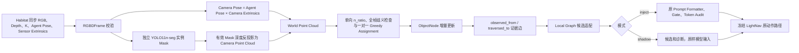

# ConceptGraphs-Lite L3 V1.1：Geometry-only 第一阶段

## 来源与实现边界

本项目借用 [ConceptGraphs 原论文](https://concept-graphs.github.io/assets/pdf/2023-ConceptGraphs.pdf) 的**有位姿 RGB-D → 实例点云 → 跨视角物体关联 → 增量物体地图**主线。原论文使用类别无关实例分割，使用 CLIP/DINO 视觉特征与三维最近邻比例共同关联物体，融合点云，再由视觉语言模型生成物体描述、语言模型推断物体间关系。论文脚注允许用封闭类别分割模型替代类别无关模型；[官方项目说明](https://concept-graphs.github.io/)也描述了这些步骤。

LightNav 的 Lite 改造只采用原论文的几何建图主线。它用独立的 `yolo11n-seg.pt` 产生带封闭类别标签的真实实例 Mask，以原版 `overlap` 模式的单向 `n_ratio` 作为几何相似度，不使用 CLIP、SAM、DINO 语义特征、GPT/VLM 关系生成或新的学习式匹配网络。图中只允许 `observed_from` 和 `traversed_to` 两种可追溯边，不生成论文中的物体间推断关系。LightNav 的冻结模型、原视频输入、Pointing/RVQ 输出与动作解码保持原样；三维图只作为现有 Local Graph 候选源。

| 机制 | 原论文 | 本项目 Lite L3 |
| --- | --- | --- |
| 实例来源 | 类别无关分割，可替换为类别模型 | 独立 YOLO11n-seg Mask；原 YOLO11n L1 检测器照旧运行 |
| 三维化 | 有位姿 RGB-D，Mask 像素反投影与去噪 | 对齐 RGB-D、同一时刻 K 与相机世界位姿；过滤无效深度后反投影 |
| 对象关联 | 原仓库 `overlap` 模式用新检测点到历史点云的单向最近邻比例 `n_ratio`；完整路线另聚合 CLIP 视觉余弦 | 仅用 `n_ratio`；类别和几何门控、全帧一对一 Greedy Assignment、歧义弃权属于本项目适配 |
| 物体融合 | 点云并集与降采样，融合语义特征 | 点云增量更新及容量约束，更新包围盒、中心、次数和 Evidence |
| 图关系 | 语言模型从物体描述与位置推断关系 | 仅真实实例观测 `observed_from` 与有转移记录的连续轨迹 `traversed_to` |
| 导航 | 图可用于另行规划和问答 | 现有 Local Graph Fusion 和 Prompt Gate；无第二规划器 |

### 原版 `n_ratio` 与本项目的一对一适配

本地原版 [utils.py](../../reference_repos/ConceptGraphs/conceptgraph/slam/utils.py) 的 `compute_overlap_matrix_2set`（第 268–323 行）把**当前检测点云**中的每个点作为查询，在**历史物体点云**中找最近邻。若最近邻平方距离严格小于 `downsample_voxel_size²`，该点计入重叠；`n_ratio = 命中检测点数 / 检测点总数`。函数注释对分母的描述与第 318–321 行实际除法不一致，本项目以可执行代码的**新检测点数**为准。这是单向比例，不能改成两个方向比例的最小值、中心距离分数或包围盒 IoU 分数。原版先以 3D 包围盒 IoU `< 1e-6` 跳过不相交的候选；[mapping.py](../../reference_repos/ConceptGraphs/conceptgraph/slam/mapping.py) 第 17–44 行把该比例用作 `overlap` 模式的空间相似度。原版完整关联路线还计算 CLIP 余弦并聚合视觉与空间相似度，本阶段不采用这一部分。

原版 [streamlined_mapping.py](../../reference_repos/ConceptGraphs/conceptgraph/slam/streamlined_mapping.py) 第 56–80 行虽按检测最佳分数排序，却明确允许多个检测匹配同一个历史物体；[mapping.py](../../reference_repos/ConceptGraphs/conceptgraph/slam/mapping.py) 第 83–102 行也按检测逐个融合。本项目要求的**同帧一对一 Greedy Assignment**、类别一致、中心距离门控、接近最优时弃权，以及已占用旧节点的竞争者新建节点，均是 Geometry-only 消融的保守适配，不能称为原版原样实现。

## 真实数据流

每次图更新只消费同一次 `reset` 或 `step` 返回的 RGB、Depth、K、Agent Pose 与 Sensor Extrinsics。K 的宽高必须与 RGB 和 Depth 完全一致。Habitat 在线路上可能把 Depth 按传感器 `min_depth`/`max_depth` 截断后归一化到 `[0,1]`；L3 必须按同一步元数据声明的编码和范围还原米数，并把归一化的 `0`、`1` 端点以及米制的量程端点视为截断值，不当作可靠实测深度。没有可靠编码/范围、元数据或图像未对齐时，放弃几何更新。Mask 必须与该 RGB 逐像素对应，不能由 L1 检测框填充代替。

## 坐标与数值约束

世界点的变换顺序为 `T_world_camera = T_world_agent × T_agent_camera`，随后 `p_world = T_world_camera × p_camera`。Agent Position 不能代替 Camera Position。相机内参 `K = [[fx,0,cx],[0,fy,cy],[0,0,1]]` 按原生传感器分辨率使用，不沿用 LightNav 视频预处理后的尺寸。Habitat 世界坐标以米为单位、`+Y` 向上；传感器相机坐标 `+X` 向右、`+Y` 向上、`-Z` 向前。深度 `d` 的像素 `(u,v)` 先转为 `((u-cx)d/fx, -(v-cy)d/fy, -d)`。线路上的四元数采用 **`[w,x,y,z]`**，转换前验证有限值、长度和范数，不猜测顺序。

Mask 像素只有在 Depth 为有限、正值且处于传感器有效范围时才参与点云。图像尺寸不一致、K 无效、位姿或外参缺失、有效点数不足时，候选的 `geometry_status` 不可信，不能把伪造的距离或方位送入 Prompt。深度空洞、表面稀疏、遮挡与分割误差会降低三维重叠，因此几何阈值是工程门槛，不是校准后的身份概率。

纯几何关联以每次更新前的**全部历史物体**和本帧全部有效 Mask 构造候选。每一对先要求类别相同、中心距离不超过 `max_center_distance_m`、扩张后的轴对齐三维包围盒 IoU 至少为 `min_bbox_iou`。随后逐个查询新检测点的历史点云最近邻；当最近邻平方距离严格小于 `voxel_size_m²` 时计入命中，`n_ratio = 命中点数 / 新检测点数`。只有最佳候选的 `n_ratio ≥ min_overlap_ratio` 才可提议合并；次佳候选即使低于此下限，仍保留在歧义比较中。薄表面包围盒只在 IoU 门控时按 `voxel_size_m` 扩张，不把未见表面写进 `ObjectNode.bbox_3d`。原版使用三维包围盒预筛和同一定义的单向 `n_ratio`；这里的类别、中心、扩张轴对齐框及其阈值都是本项目的保守适配。

每个检测的最佳和次佳分数必须先从**完整历史候选集**计算，不能因为某旧节点已经被本帧另一检测占用，就从歧义判断中删除它。两者 `n_ratio` 差小于 `ambiguity_margin_ratio` 时，该检测弃权并建立新节点。其余检测按最佳 `n_ratio` 从高到低贪心分配，每个历史节点本帧至多接收一个检测；竞争者若失去最佳节点，也建立新节点，不退而使用次佳节点。这套一对一和弃权规则用于降低误合并，不声称是原版仓库的分配器。

| `GeometryConfig` 参数 | 初值 | 用途及依据 |
| --- | ---: | --- |
| `min_depth_m` / `max_depth_m` | 0.1 / 10 m | 剔除非物理或超量程值；仍须遵守真实传感器更窄的有效范围 |
| `min_points` | 8 | 拒绝点数太少的几何观测 |
| `max_points_per_instance` / `max_points_per_object` | 256 / 2048 | 限制在线点云计算和地图内存，不能理解为原论文默认值 |
| `voxel_size_m` | 0.03 m | 点云降密体素边长，同时是原版 `n_ratio` 最近邻距离门槛 |
| `max_center_distance_m` | 0.75 m | 候选中心的保守搜索范围 |
| `min_overlap_ratio` | 0.35 | 新检测点的单向最近邻命中比例下限；数值为本项目初值 |
| `min_bbox_iou` | 0.01 | 扩张轴对齐三维包围盒 IoU 的预筛下限，不是匹配分数 |
| `ambiguity_margin_ratio` | 0.12 | 最佳与次佳 `n_ratio` 的差小于此无量纲阈值时拒绝合并 |
| `min_travel_distance_m` | 0.01 m | 小于此观测位移不构成轨迹边，避免原地抖动产生通行边 |

距离阈值按米设置，IoU、`n_ratio` 和歧义差均无量纲。体素距离 0.03 m 与本项目点云采样密度相配，可能使跨视角不重叠表面保守地分裂成两个节点。必须在 AutoDL 上用真实 Habitat RGB-D、不同视角和相邻同类实例标注检查误合并率、漏合并率，再决定是否调整；这里不声称已标定或达到某种准确率。

## 图与证据契约

`ObjectNode` 至少保存 `object_id`、`class_name`、`center_world`、`bbox_3d`、`observation_count`、`evidence_ids`、`geometry_status` 与受限大小的世界点云。每个 L3 分割实例独立产生规范化 Evidence ID，记录来源 Scene、Episode、rollout、Step、类别、分割分数、Mask 像素数和有效深度点数；可选记录与同类 L1 框的高 IoU 对应关系。L1 对应失败或歧义不会阻止独立 L3 建图，也不会改写 L1 Evidence。无有效深度的 Mask Evidence 标为 `rejected_depth`，不创建 `observed_from`。每次真实观测保留 Viewpoint。两个相邻同类物体只因类别相同或接近而不能合并；若最佳与次佳候选无法区分，则创建新节点。

`observed_from` 连接物体和产生该点云的真实 Viewpoint，必须同时具有有效实例 Mask、Depth、Camera Pose 和 Evidence。`traversed_to` 只能连接连续实际观测的 Viewpoint，必须有前后有效位姿与真实环境 `step` 转移记录。仅有动作命令、视觉变化、空间接近或语义共现均不能证明通行。这里的 `traversed_to` 表示环境确实产生了相邻状态，不单凭它宣称某条未来路径可通行。

V1.1 的三维物体地图按 Scene、Episode 和 rollout 隔离，并在每轮 reset 清空；即使原 L2/Local Graph 使用 `scene_persistent`，L3 也**不跨 Episode 复用三维对象**。不能把上一轮的位置或通行状态误当成当前状态。图的边类型限定为以上两种，不追加物体间推断边。

## 检索、Prompt 与模式

三维适配器沿用现有 Local Graph 的 `MemoryContext` 候选与 Prompt 接口；有可信三维候选时走同一 Prompt 构造、预算和审计链，缺失时调用原 `LocalGraphFusion`。L1、L2、旧候选筛选、Prompt Formatter、Prompt Gate、Token Audit 和原 Prompt 回退均保留。候选可包含历史类别、历史观测位置、相对距离、相对方位、观测次数、Evidence 来源。Prompt 准入还要求独立 L3 分割分数不低于可配置的 `min_injection_confidence`（初值 0.5）；这个分数不是身份概率。距离和方位只由有效当前位姿与可信世界坐标计算；没有真实通行证据时通行状态为未知。

`shadow` 建图、关联、检索并写诊断，但给模型的最终 sample、Prompt、Token ID 和动作与原始基线一致。`inject` 仅允许可信三维候选进入既有 Prompt 审计链；可信候选为空时沿用原 Local Graph，几何不足时不补写距离、方位或通行事实。两种模式都不触及权重与动作预测算法。

## 验证与限制

CPU 单元测试使用 Fake YOLO 分割器和合成 RGB-D/位姿，覆盖输入校验、反投影、外参组合、坐标变换、单向 `n_ratio`、跨视角同物体关联、相邻同类物体、完整历史候选歧义弃权、同帧竞争与一对一分配、点云增量更新、Evidence、边约束、场景隔离、候选适配和 Shadow 零影响。2026-11-15 的本阶段定向测试：`pytest -q tests/memory/test_conceptgraphs_lite.py tests/memory/test_yolo_seg_extractor.py tests/habitat/test_spatial_rgbd_info.py tests/habitat/test_spatial_l3_policy.py tests/habitat/test_spatial_l3_launcher_guard.py`，使用本机已有 Python 3.11 与当前仓库虚拟环境的 site-packages，结果 **44 passed**，其中核心几何测试文件 **21 passed**。Local Graph 与 Habitat runner 相关回归测试另得 **68 passed、5 skipped、6 subtests passed**。

仓库级 `pytest -m 'not gpu'` 原样运行出现既有 `test_rgm_place.py::test_initial_reference_and_global_ambiguity` 的期望字符串失败，随后长时间无输出，已中断；排除 `tests/test_batcher.py` 及该测试和 `test_tracking_service.py::test_predict_reraises_only_the_failing_sessions_decode_error` 后，CPU 套件为 **994 passed、14 skipped、2 deselected、82 subtests passed**。本阶段涉及的 Python 文件 Ruff 检查与 `git diff --check` 通过；全仓 `ruff check .` 报 731 项，位于本阶段未修改的参考仓库和既有文件中。上述排除和静态检查范围必须随结果一并报告。

真实 Habitat + YOLO11n-seg + checkpoint 的端到端质量、几何阈值标定、真实 Prompt/Token/动作一致性和任何 SR/SPL 变化必须在 AutoDL 另行验证；CPU Fake 测试不能替代这些结果。

已知限制：YOLO11n-seg 是封闭类别模型；薄物体、反光和严重遮挡会造成深度或 Mask 失效；离散点云的世界精度取决于 Habitat 深度、内参和传感器姿态。地图不自动推断物体间关系或未来路径可通行性。
