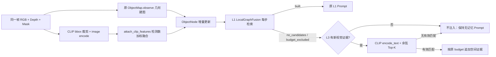

# L1 Original + 按需 L3 CLIP 查询（V1）

## 目标与边界

本方案在现有 Geometry-only ConceptGraphs-Lite L3 上增加**按需**文本查询，不替换
L1 Original。L1 仍由 `LocalGraphFusion` 每步检索；只有它明确返回空候选时，才用
本地 CLIP 文本特征查询 L3 对象节点，并把 Top-K 匹配的空间证据追加到原 Prompt
适配器。方案不改变 L3 建图、几何匹配、3D IoU、点云重叠、对象融合、LightNav
权重、动作解码或原 Prompt Token Budget，也不调用任何外部 API。

## ConceptGraphs 官方实现对应关系

参考仓库：`/home/lilixing/projects/references/ConceptGraphs`（official
`concept-graphs/concept-graphs` main, commit `93277a0`）。

| 环节 | 官方源码位置 | 官方行为 | LightNav 复用方式 |
| --- | --- | --- | --- |
| 对象视觉特征 | `conceptgraph/utils/model_utils.py:75-129` `compute_clip_features`；批量版 `:131-180` | 对每个检测框向外扩 20 px（边界截断），从整帧裁剪后经 CLIP `encode_image`，再 L2 normalize（`:81`, `:105-111`, `:168-172`） | `clip_features.py::clip_crop_boxes` 用实例 Mask 的紧包围盒做同样的 20 px 扩边裁剪；`LocalClipEncoder.encode_image` 调 OpenCLIP `encode_image` 并 L2 normalize |
| 多视角融合 | `conceptgraph/slam/utils.py:178-222` `merge_obj2_into_obj1`，特征行 `:208-220` | `(old * n_old + new * n_new) / (n_old + n_new)`，再 L2 normalize；`n` 为该对象累计检测数（新检测 `n_new=1`） | `clip_features.py::fuse_clip_feature` 完全相同的检测数加权平均 + normalize；`ObjectMap.attach_clip_features` 按 Evidence ID 幂等融合 |
| 特征存储 | `conceptgraph/slam/slam_classes.py:102-156` `MapObjectList`；`slam/utils.py:544-565` 检测字典 | 每个对象保存一个 `clip_ft` 与一个 `text_ft`（Tensor）；`to_serializable` 转 NumPy | 每个 `ObjectNode` 保存 `clip_feature`（float32, L2-normalized）、`clip_feature_observations`、`clip_feature_evidence_ids`；不改变原节点身份与几何字段 |
| 文本特征 | `model_utils.py:113-119`；`scripts/visualize_cfslam_results.py:277-280` | 类别文本（建图）或用户查询文本（检索）经 `encode_text` 后 L2 normalize | `LocalClipEncoder.encode_text` 使用同一 OpenCLIP tokenizer/文本塔；只对查询文本编码 |
| 余弦检索 | `slam/slam_classes.py:103-116` `compute_similarities` | `F.cosine_similarity(new_clip_ft, object_clip_fts)` | `clip_features.py::cosine_similarity` 与 `l3_clip_query.py` 对存储特征做同一余弦打分 |
| 文本查询结果组织 | `scripts/visualize_cfslam_results.py:269-293` `color_by_clip_sim` | 文本 encode + normalize，余弦相似度，`softmax`/`argmax` 取最大；`scripts/build_scenegraph_cfslam.py:295` 使用 `np.argsort(...)[::-1]` | 官方仓库没有独立 Top-K 服务；本方案只在官方余弦分数上做确定性的降序选择（同分按 `object_id` 升序），Top-K 由调用者指定。没有新增相似度模型或重排序算法 |

官方 `text_ft` 保存的是对象类别文本特征，主要服务于重复对象合并/类别一致性；本次
查询只需要查询文本特征与对象视觉特征，所以不额外存 `text_ft`，避免每个类别文本
重复编码。视觉与文本特征仍来自同一个 CLIP 空间，和官方检索路径一致。

## 数据流



### 建图阶段（不改几何）

1. `ObjectMap.observe` 完成后，`MemoryManager._attach_clip_features` 找出本帧
   已进入对象节点的 Evidence ID。
2. 对这些 Mask 的紧包围盒扩 20 px，批量调用本地 CLIP 图像塔。
3. `ObjectMap.attach_clip_features` 只更新节点的特征字段；不触碰点云、包围盒、
   中心、`observation_count`、Evidence、边或对象 ID。

CLIP 失败只写诊断，不影响几何建图、L1 或策略动作。

### 查询阶段

- 本地接口：`MemoryManager.query_l3_objects(text, top_k)` 或
  `l3_clip_query.query_objects(object_map, text, top_k, encoder=...)`。
- 输出：`object_id`、`rank`、`similarity`、`class_name`、`center_world`、
  `bbox_3d`、`observation_count`、`evidence_ids`、`geometry_status`、
  `point_count`、`clip_feature_observations`、`latest_step`、
  `detector_confidence`。`similarity` 是原始余弦，`detector_confidence` 是
  YOLO 分割分数，二者都不是“CLIP 检索置信度”。
- `candidates` 记录所有有效特征的 `rank`、原始余弦、Object ID、Evidence ID 和
  `decision`（`matched` / `ranked_out_by_top_k` / `below_positive_cosine` /
  `below_min_similarity`），即使没有注入也可审计。
- 空查询、空地图、无特征、文本/对象维度不一致、无正余弦匹配都返回显式
  `skipped_reason`，不抛异常、不返回伪造对象、不重建地图。
- `clip_min_similarity` 默认 `0.0`：余弦的数学符号边界，不是调参得到的置信度。
  匹配还必须有**严格正**余弦（正交/零分不算语义相关）；官方查询代码本身不做
  阈值过滤，该规则只用于“无有效匹配时不注入”。

### 触发控制器

`L3QueryController` 只接受两种 L1 状态：

- `no_candidates`：`LocalGraphFusion` 的当前/历史候选都为空；
- `budget_excluded`：L1 选中过候选，但所有行都超过原字符预算。

`reactivation_suppressed`（L1 有卡片、只是为避免重复而抑制）不会触发 L3。
`built` 时永远不调用文本编码器。控制器用“对象特征签名 + 查询文本”去重：
同一张 L3 地图、同一查询文本最多查询一次；只有新视觉证据或查询文本改变才允许
再次查询。因此即使 L1 连续多步为空，也不会出现每步强制 CLIP 查询。

每步记录 `query_executed`、`query_source`、`last_query_step`、
`steps_since_last_query`、`skipped_reason` 和累计 `l3_query_stats`：
`queries_attempted`、`queries_with_match/without_match`、
`prompt_budget_excluded`、`skipped_reasons`，以及
`query_trigger_rate`、`match_rate_of_queries`、`queries_injected`、`injection_rate_of_l1_empty`。
长期不查询时先看这些计数，不要放宽余弦阈值来制造查询。

### Prompt 融合

复用原 `inject_memory_context`、`[Navigation Memory]` 头和
`min(local_graph.prompt_max_chars, memory.max_context_chars)` 预算。只追加
Top-K 匹配行，例如：

L1 为空、无 L3 匹配时（原 Prompt 不变）：

```text
You are a navigation agent. <navigation_task>find the sofa.</navigation_task>.
```

L3 命中时（在原任务句后追加，原任务文本和原有后置内容不动）：

```text
... <navigation_task>find the sofa.</navigation_task>. [Navigation Memory]
L3 CLIP cos 0.412: sofa at world (2.1,0.3,-3.4)m; 3.9m, -8deg (left +); 2obs; passage unknown.
```

没有可信通行证据时始终写 `passage unknown`；不使用未观测到的物体、距离、
方位或路径。紧凑行是为了让 3 条 Top-K 结果能放进 legacy 的 320 字符预算；
在 `l1_original_only` 的 token-aware 模式下仍由原 `_result` 整行 token 选择
控制，320 字符只是测量失败时的回退值，600 字符不是硬上限。

自动 Controller 默认传入完整 R2R 指令（官方查询接口接受调用者文本，不解析）；
短对象地标短语只能通过显式 `query_text` 或 `query_l3_objects` 传入，本方案不新增
自动短语解析器。整句/短语的真实 CLIP 差异需在 GPU 上用原始余弦和 candidates
审计，CPU Mock 只验证文本原样传递。

## 模式与配置

`spatial_l3.mode` 新增 `on_demand`，原有 `off` / `shadow` / `inject` 行为不变。
`on_demand` 允许 `legacy` 或 `l1_original_only` Prompt 模式；后者保留历史
75% SR 的 L1 Original 原文、320/600 参数和 token 预算，只在 L1 空时追加 L3。
其他六组消融模式仍拒绝该组合。需要本地 CLIP checkpoint：

| 参数 | 默认 | 说明 |
| --- | ---: | --- |
| `--spatial_l3_mode on_demand` | `off` | L1 优先，L1 空才查询 L3 |
| `--spatial_l3_clip_model_path FILE` | empty | 本地 OpenCLIP checkpoint；不下载 |
| `--spatial_l3_clip_model_name` | `ViT-H-14` | 与官方一致的结构名 |
| `--spatial_l3_clip_device` | `cpu` | 本地推理设备 |
| `--spatial_l3_clip_precision` | `fp32` | `fp16` 可降低 4090 D 显存 |
| `--spatial_l3_clip_batch_size` | `8` | 限制 CLIP 激活峰值 |
| `--spatial_l3_clip_top_k` | `3` | 最多注入的匹配对象数 |
| `--spatial_l3_clip_min_similarity` | `0.0` | 余弦符号边界，不是调参阈值 |

## CPU 测试

测试用确定性 Mock 特征，不下载权重、不启动 GPU、不启动 HTTP 服务：

- 特征维度、L2 normalize、20 px 裁剪、检测数加权融合；
- 余弦相似度、Top-K 排序/截断/同分确定性；
- 空查询、空地图、无特征、维度不一致、无匹配；
- 对象 ID/几何不变、特征融合幂等；
- 多次归一化融合与官方 `merge_obj2_into_obj1` 两两顺序合并等价；
- 正余弦只记录为原始相似度，不写入 `confidence`；candidates 记录 rank/Evidence/
  拒绝原因；
- L1 成功不调用文本编码器；`l1_original_only` 与 legacy 两条路径均验证；
- L1 空才查询，地图不变不重复查询；触发率/跳过原因可统计；
- L3 无结果不注入，有结果只注入 Top-K；
- 3 条紧凑 L3 行可放进 320 字符；`l1_original_only` token-aware 预算可注入；
- 原 L1 Prompt 逐字节不变、原任务后缀不变、原字符预算不被突破；
- 真实 R2R 指令形式与短地标短语的文本原样传递（Mock 仅验证 plumbing）。

AutoDL 启动、预检、单 Episode smoke、88 Episode 命令和 4090 D 显存预算见
[L3_ON_DEMAND_AUTODL.md](L3_ON_DEMAND_AUTODL.md)。
