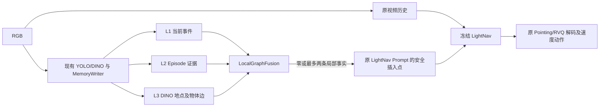

# Local Graph Navigation Context：独立实验设计

## 方案选择

主机制取自 OVER-NAV 的 **local ego-centric subgraph**：只从当前视觉地点的局部邻域抽取少量任务关键词。LightNav 不具备 OVER-NAV 的学习式图融合层，所以本实验把局部图证据转换为冻结 Qwen3-VL 可读的短文本，插在原 `</navigation_task>` 后；原指令、RGB 历史、时间戳、Pointing Token、RVQ Token 和动作解码不变。HSGM 的俯视地图依赖 RGB-D/位姿与额外 VLM；HiMemVLN 的核心导航器不在本地 checkout，均未作为实现骨架。

新模块是 [local_graph_fusion.py](../../src/lightnav/memory/local_graph_fusion.py)，独立参数在 [local_graph_config.py](../../src/lightnav/memory/local_graph_config.py)。[manager.py](../../src/lightnav/memory/manager.py) 沿用三层写入和 V3 Evidence Store；新模块不调用 V4 Retriever/Formatter，也不修改其选择状态。[policy.py](../../src/lightnav/habitat/policy.py) 为新开关单独构造 sample、注入、做 Prompt 往返审计，并在 Processor/vLLM 最终 Token 诊断通过后确认一次注入。模型输入过长时逐条撤除完整事实，最后回到原 sample。

## 信息组织和触发

| 来源 | 新方案写给模型的含义 | 限制 |
| --- | --- | --- |
| 当前 YOLO 事件和框 | 与原指令词有交集且检测分数至少 0.5 的地标；框中心可标为当前 RGB 的 left/center/right。 | 这是当前图像的检测结果，不表示房间身份、通行或任务完成；每类取最高分。 |
| 当前 DINO 地点节点的一跳 landmark 边 | 仅取同 Scene、该视觉地点相关边所连接的过往地标证据，写成“相似视觉区域曾见过 …，可能重访；当前方位与通行未知”。 | 图边为 `inferred_relation`，没有度量距离、当前方位或已执行通行证明。当前没有 DINO 地点节点时不取全局历史。 |
| L2/V3 证据日志 | 每条上下文保留规范化 Scene/Episode/rollout/Step/Evidence ID 到诊断 metadata。 | 不在 Prompt 中堆叠长 ID；不采用历史模型文本或 evaluator 距离作为事实。 |

语义相关性取规范化标签词与原指令词的**非空交集**，使 `dining table` 可服务于 `find the table`；局部一跳、仅观察事件、置信阈值和条数限制约束误召回。检测类别不等于实例身份；同类物体在不同时刻不自动合并成同一物体。

每步先选择当前视图语义，再选择当前 DINO 地点的一跳历史。最多两条、默认整个卡片 320 字符；一条历史事实可替换较低优先级的当前重复标签。无有用证据时直接使用原始 sample。已确认进入最终模型输入的相同卡片在 8 步内不重复注入；地点或所选语义变化立即重新激活，之后同卡片也可周期性出现。这是提示调度，不是主动转向、回退或停止策略。仅保留选中证据的实际模型输入确认，Processor 拒绝或 vLLM Token 不一致时不计注入。

相比 FIX3 的“V3 四通道 Top-K → 分散事实 → 来源串 → 特定使用模式”，此方案是“当前视图/当前视觉地点 → 一跳任务地标 → 一张短卡”。FIX3 会排除仍在原生 RGB 历史里的视觉事实；新方案允许当前 RGB 的 YOLO **语义解释**进入卡片，因此不会把“帧已在视频中”误当成“冻结模型已理解该检测标签”。它也不会把全部历史候选逐条放入 Prompt。

## 实验开关与隔离

| 组 | 开关 | 输出目录示例 |
| --- | --- | --- |
| A `baseline_off` | 不传 `--memory_enabled` | `output/episode1_localgraph_a_<run>` |
| B `rgm_v4_fix3` | `--memory_enabled --memory_strategy hierarchical --memory_layers short,mid,long --rgm_v4_enabled` | `output/episode1_localgraph_b_<run>` |
| C `local_graph` | 同一 memory/YOLO/DINO 参数，加 `--local_graph_enabled`，不加 V4 开关 | `output/episode1_localgraph_c_<run>` |

V4 和新开关互斥。C 在新空目录写 `local_graph_protocol.json`；A/B/C 都使用 `--episodes 1 --trace_steps` 并分别写 RGB、逐步 Prompt/Token/动作、结果与 manifest。B 仍写原 `rgm_v4_protocol.json`。每组必须从相同的单 Episode 服务命令、相同 checkpoint 与 RVQ bundle、同种子、同环境配置开始；评测结束会关闭服务端，所以 A/B/C 各重启一次，再核对初始位姿、RGB 和指令完全一致。任何一次 Prompt 变化都是实验变量，不能宣称三个策略走过不同 RGB 后仍有逐步同观测反事实比较。

## 证据与局限

- `distance_to_goal`、成功标志和服务端 `agent_pose` 只进 evaluator 的 `step_trace.jsonl`，不进入 `ObservationPacket` 或记忆检索；位姿只用于离线分析。
- 上述 Legacy Local Graph 没有深度投影、实例级 YOLO 跟踪、实际里程计或拓扑边方向；历史地标的方位/距离写成未知。新增可切换的空间模式仅用 Habitat 实测 Agent Pose 算到历史**观测视点**的直线距离/相对方位，仍不能把 DINO 相似地点称为已验证重访，也不能把该方位当成可执行路径。见 [OVER_NAV_SPATIAL_FUSION.md](OVER_NAV_SPATIAL_FUSION.md)。
- 当前方案能验证“记忆是否进入模型输入”和“是否改变动作”；能否改善 Episode 1、SR、SPL 需要真实 AutoDL 评测。Episode 1 的首次错误转向需结合参考路线、位姿和 RGB 手工确认，不能从同一步的动作分歧直接命名为错误。
