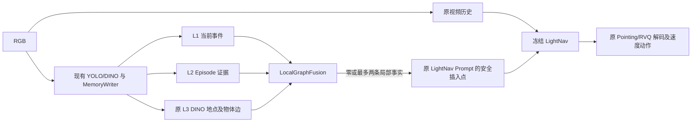

# Local Graph Navigation Context 与 ConceptGraphs-Lite L3

本文前半部分记录已完成的 `local_graph_v1` 实验设计；其中的 L3 是 DINO 视觉地点假设，并无 RGB-D 三维几何。新 L3 V1.1 是在保留该路径、L1 和 L2 的前提下新增的 ConceptGraphs-Lite 物体地图，详见 [CONCEPTGRAPHS_LITE_L3.md](CONCEPTGRAPHS_LITE_L3.md)。两种路径的证据强度和运行结果不能混称。

## 方案选择

主机制取自 OVER-NAV 的 **local ego-centric subgraph**：只从当前视觉地点的局部邻域抽取少量任务关键词。LightNav 不具备 OVER-NAV 的学习式图融合层，所以本实验把局部图证据转换为冻结 Qwen3-VL 可读的短文本，插在原 `</navigation_task>` 后；原指令、RGB 历史、时间戳、Pointing Token、RVQ Token 和动作解码不变。HSGM 的俯视地图依赖 RGB-D/位姿与额外 VLM；HiMemVLN 的核心导航器不在本地 checkout，均未作为实现骨架。

新模块是 [local_graph_fusion.py](../../src/lightnav/memory/local_graph_fusion.py)，独立参数在 [local_graph_config.py](../../src/lightnav/memory/local_graph_config.py)。[manager.py](../../src/lightnav/memory/manager.py) 沿用三层写入和 V3 Evidence Store；新模块不调用 V4 Retriever/Formatter，也不修改其选择状态。[policy.py](../../src/lightnav/habitat/policy.py) 为新开关单独构造 sample、注入、做 Prompt 往返审计，并在 Processor/vLLM 最终 Token 诊断通过后确认一次注入。模型输入过长时逐条撤除完整事实，最后回到原 sample。

## 信息组织和触发

| 来源 | 新方案写给模型的含义 | 限制 |
| --- | --- | --- |
| 当前 YOLO 事件和框 | 与原指令词有交集且检测分数至少 0.5 的地标；框中心可标为当前 RGB 的 left/center/right。 | 这是当前图像的检测结果，不表示房间身份、通行或任务完成；每类取最高分。 |
| 当前 DINO 地点节点的一跳 landmark 边 | 仅取同 Scene、该视觉地点相关边所连接的过往地标证据，写成“相似视觉区域曾见过 …，可能重访；当前方位与通行未知”。 | 图边为 `inferred_relation`，没有度量距离、当前方位或已执行通行证明。当前没有 DINO 地点节点时不取全局历史。 |
| L2/V3 证据日志 | 每条上下文保留规范化 Scene/Episode/rollout/Step/Evidence ID 到诊断 metadata。 | 不在 Prompt 中堆叠长 ID；不采用历史模型文本或 evaluator 距离作为事实。 |

语义相关性取规范化标签词与原指令词的**非空交集**，使 `dining table` 可服务于 `find the table`；局部一跳、仅观察事件、置信阈值和条数限制约束误召回。检测类别不等于实例身份；同类物体在不同时刻不自动合并成同一物体。

每步先选择当前视图语义，再选择当前 DINO 地点的一跳历史。最多两条、默认整个卡片 320 字符；一条历史事实可替换较低优先级的当前重复标签。无有用证据时直接使用原始 sample。已确认进入最终模型输入的相同卡片在 8 步内不重复注入；地点或所选语义变化立即重新激活，之后同卡片也可周期性出现。这是提示调度，不是主动转向、回退或停止策略。仅保留选中证据的实际模型输入确认，Processor 拒绝或 vLLM Token 不一致时不计注入。

相比 FIX3 的“V3 四通道 Top-K → 分散事实 → 来源串 → 特定使用模式”，此方案是“当前视图/当前视觉地点 → 一跳任务地标 → 一张短卡”。FIX3 会排除仍在原生 RGB 历史里的视觉事实；新方案允许当前 RGB 的 YOLO **语义解释**进入卡片，因此不会把“帧已在视频中”误当成“冻结模型已理解该检测标签”。它也不会把全部历史候选逐条放入 Prompt。

## 实验开关与隔离

| 组 | 开关 | 输出目录示例 |
| --- | --- | --- |
| A `baseline_off` | 不传 `--memory_enabled` | `output/episode1_localgraph_a_<run>` |
| B `rgm_v4_fix3` | `--memory_enabled --memory_strategy hierarchical --memory_layers short,mid,long --rgm_v4_enabled` | `output/episode1_localgraph_b_<run>` |
| C `local_graph` | 同一 memory/YOLO/DINO 参数，加 `--local_graph_enabled`，不加 V4 开关 | `output/episode1_localgraph_c_<run>` |

V4 和新开关互斥。C 在新空目录写 `local_graph_protocol.json`；A/B/C 都使用 `--episodes 1 --trace_steps` 并分别写 RGB、逐步 Prompt/Token/动作、结果与 manifest。B 仍写原 `rgm_v4_protocol.json`。每组必须从相同的单 Episode 服务命令、相同 checkpoint 与 RVQ bundle、同种子、同环境配置开始；评测结束会关闭服务端，所以 A/B/C 各重启一次，再核对初始位姿、RGB 和指令完全一致。任何一次 Prompt 变化都是实验变量，不能宣称三个策略走过不同 RGB 后仍有逐步同观测反事实比较。

## 证据与局限

- 原 `local_graph_v1` 路径的 `distance_to_goal`、成功标志和服务端 `agent_pose` 只进 evaluator 的 `step_trace.jsonl`，不进入 `ObservationPacket` 或旧检索；新 L3 显式读取同一步 `spatial_rgbd` 中的相机位姿元数据，仍不读取目标距离或成功标志作为导航事实。
- 原 `local_graph_v1` 路径没有深度投影、实例级 YOLO 跟踪、实际里程计或拓扑边方向；该路径历史地标的方位/距离必须写成未知。DINO 相似是地点假设，不能称为已验证的重访。ConceptGraphs-Lite L3 只在新的显式模式中使用真实 RGB-D、位姿和分割实例，不能把其几何结论回填为旧实验事实。
- 当前方案能验证“记忆是否进入模型输入”和“是否改变动作”；能否改善 Episode 1、SR、SPL 需要真实 AutoDL 评测。Episode 1 的首次错误转向需结合参考路线、位姿和 RGB 手工确认，不能从同一步的动作分歧直接命名为错误。

## ConceptGraphs-Lite L3 V1.1 增量设计

新 L3 只在 Habitat 同一步提供对齐 RGB、Depth、K、Agent Pose 和 Camera Extrinsics 时创建可信三维对象。线路上的 Depth 可能是截断后归一化值，L3 按传感器声明的编码和范围换算成米并舍弃量程端点。独立的 `yolo11n-seg.pt` 输出像素级 Mask，并为每个实例生成独立 Evidence；原 `yolo11n.pt` L1 检测和 Evidence 写入保持不变，L2 原实现暂时保留。相机世界位姿由 `Agent Pose × Camera Extrinsics` 计算，不能把 Agent Position 直接当相机中心；具体坐标、过滤规则、图结构和保守几何门槛见 [实现说明](CONCEPTGRAPHS_LITE_L3.md)。

物体地图只添加真实对象观测的 `observed_from`，以及连续真实环境转移且前后位姿有效的 `traversed_to`。L3 物体地图在 V1.1 每 Episode 重置，不跨 Episode 复用，即使旧 L2 为 `scene_persistent`。旧 DINO 地点图上的 `inferred_relation` 不被升级为上述事实边；旧 Local Graph 仍可作为几何缺失时的回退候选。新候选经已有 Local Graph Fusion 入口、原 Prompt Gate 和 Token Audit 后，才可能进入模型输入。没有可靠几何时不生成距离、方向或通行状态。

Geometry-only 第一阶段把匹配分数明确收敛到 ConceptGraphs 原版 `overlap` 模式的单向 `n_ratio`：当前 Mask 点云中最近历史物体点距离严格小于体素边长的点数，除以当前 Mask 的点数。不再把双向点云比例、中心距离与 IoU 混合为匹配分数，也不采用原版完整路线的 CLIP 视觉相似度。本项目另外要求同类别、中心距离和扩张包围盒 IoU 门控；每个检测先在**全部历史节点**中检查最佳与次佳比例差，歧义则新建节点，再按分数做同帧一对一 Greedy Assignment。原仓库的逐检测融合允许同一个历史物体接收多个检测；这里的一对一和弃权是为避免错误合并而新增的消融适配，详见 [实现说明](CONCEPTGRAPHS_LITE_L3.md)。

`shadow` 模式执行分割、三维关联、历史检索和诊断，却必须维持原始基线的 Prompt、最终 Token ID 和动作。`inject` 模式只允许可信三维候选通过原预算和审计链；无候选或审计失败时按既有规则回退。两种模式需分开输出与报告，不能把 Shadow 的构图成功写成模型利用或导航收益。CPU Fake 测试验证算法和零影响契约；真实 Habitat、权重与 SR/SPL 仍需 AutoDL 验证。
