# OVER-NAV 空间记忆融合：源码审查与适配依据

审查基线：主仓库 `2fb184e`（`baseline-local-graph-fusion-88-sr75`）；参考仓库 `.references/OVER-NAV-IVLN-CE` 的 `0d75354323ceed4f63effd11902752cac2b38745`。本文先记录**修改前**的数据链路，再说明空间模式的设计边界。参考仓库仅用于研究，不作为依赖，也不复制其实现。

## 论文与官方代码对照

论文：[OVER-NAV, arXiv:2403.17334v1](https://arxiv.org/html/2403.17334v1)。下表中的代码路径均相对于[官方仓库](https://github.com/uitrbn/OVER-NAV-IVLN-CE/tree/0d75354323ceed4f63effd11902752cac2b38745)；行号以本地参考 checkout 为准。

| 问题 | 论文中的机制 | 官方源码及实际行为 | 对冻结 LightNav 的结论 |
| --- | --- | --- | --- |
| Omnigraph 节点、边 | §3.1：已访问 viewpoint 是节点，保存关键词检测的框、标签、置信度和绝对朝向；由前一 viewpoint 到达新 viewpoint 时增加无向连接边。 | `ivlnce_baselines/common/mapping_module/keywords_mapper3.py:130–236` 动态建立 viewpoint、保存位置和全景检测。`keywords_mapper6.py:70–83,99–150` 使用预置 R2R-CE viewpoint 坐标、访问标志和按 viewpoint 保存的检测；两个 mapper 的局部检索代码都没有建立或遍历论文所述的真实行走图边。 | 保留本项目 Place、Landmark、Evidence 与边类型；不能把 DINO 相似地点或坐标邻近伪称为已验证连接。 |
| Keyword 与地点 | §3.1：每轮指令抽取里程碑关键词，再把检测关联到观测 viewpoint；复访时可用新指令更新关键词。 | `keywords_mapper3.py:174–203` 在动态 viewpoint 保存当前指令关键词的全景检测；`keywords_mapper6.py:130–150` 将指令 ID、36 个视角的检测结果关联到预置 viewpoint。 | 检测必须保留其**观测视点**与 Evidence 来源；同名地标可能在不同地点，不应仅按标签合并。 |
| 局部范围 `d_n` | §3.2：只向模型提供局部、以当前智能体为中心的子图；§3.2.1 离散环境按可达图步数；§3.2.2 连续环境按当前位置到 viewpoint 的距离。 | `keywords_mapper3.py:27,353–365` 水平欧氏半径 `<3 m`；`keywords_mapper6.py:22,253–264` 已访问且水平欧氏半径 `<7 m`。两条公开配置的阈值不同，且半径筛选不是路径可达性判定。 | 在同一 Habitat 世界坐标系内用实测位置做局部筛选；无坐标时可保留有限的视觉局部证据，但距离/路径标 `unknown`。不能把半径当通行保证。 |
| `d_v` 与 `h_v`：离散 | §3.2.1：`d_v` 为图步数；`h_v` 是沿离散连接走向目标 viewpoint 的下一跳 view index，可对应候选动作。 | 本仓库主要公开 IVLN-CE 连续实现，不能以 `keywords_mapper3/6.py` 的角度近似替代离散下一跳索引。 | LightNav 的连续动作和 RVQ 接口没有离散 viewpoint 候选动作；**不得**把到历史地点的直线方位描述成下一步动作。 |
| `d_v` 与 `h_v`：连续 | §3.2.2：给邻近 viewpoint 关键词分配连续距离与朝向。 | `keywords_mapper6.py:187–199,253–297` 用 `x,z` 计算水平距离和相对 heading；当前最近 viewpoint 的关键词取 panorama view index、距离零，其余取 viewpoint 世界位置。`keywords_mapper3.py:336–409` 使用类似局部筛选和相对 heading，但返回值中没有距离特征。 | LightNav 只对**历史观测视点**计算相对距离/方位；当前 RGB 物体的框左右与历史世界方位分别表达，不能冒充物体 3D 位置。 |
| 检测筛选与跨点去重 | §3.2.1 保留每个邻居同名最高置信框；§3.2.2 跨 viewpoint 也只保留每个关键词最高分。 | `keywords_mapper6.py:168–184,302–308` 每点最多 top-3，再按 label 跨点取最高分；该函数的 `keywords` 参数未用于筛选。`keywords_mapper3.py:389–398` 也按 label 跨点去重。 | 只迁移“少量、与任务相关”的预算思想；本项目必须保留不同地点同类地标的空间身份。当前指令词匹配在本项目显式完成。 |
| 融合到模型 | §3.2.1 将关键词、离散 view index 和距离编码后接入 HAMT；§3.2.2、附录 §9.2 将连续朝向/距离与关键词 embedding 融合，经过指令 attention 和 MAP-CMA 状态编码。 | `ivlnce_baselines/models/map_cma_policy.py:245–264,367–429` 用训练过的线性层、卷积、注意力、GRU；距离特征仅在 `DISTANCE_FEAT=True` 时进入融合层。 | 冻结 LightNav 没有这些可训练层。适配点是有来源的紧凑文本上下文，并使用现有 Prompt 注入与最终 Token 审计。 |
| 公开连续评测路径 | 论文 §3.2.2 给的是通用连续设计，实验节把 `d_n=7 m` 作为 CE 配置描述。 | `ivlnce_baselines/config/map_cma/pred_semantics/iterative_maps/2_eval_iterative.update.16.debug15.valseen.yaml:8–24`：`val_seen` 用 mapper6、预置 viewpoint/检测库、`d_n=7 m`；`.../2_eval_iterative.update.16.debug.v9.for.debug15.yaml:8–24`：`val_unseen` 用 mapper3、动态 viewpoint、`d_n=3 m`。两者启用 `KEYWORDS_MAP`，这两份 YAML 都未启用 `DISTANCE_FEAT`。 | 论文设想、两条发布配置与实际模型输入必须分别陈述；不能声称公开连续评测都使用 7 m、真实图最短路或距离嵌入。 |

官方连续路径的位姿来源是 `ivlnce_baselines/common/mapping_module/setup_mapping_module.py:77–87,117–126` 的 `world_robot_pose`/`world_robot_orientation`；四元数 heading 函数见 `habitat_extensions/utils.py:146–152`。`keywords_mapper3.py:130–153` 的动态 viewpoint 发现阈值为 1 m、重访阈值为 0.25 m；mapper6 的预置 viewpoint 绑定阈值为 0.25 m（`keywords_mapper6.py:99–115`）。这些是代码事实，不代表本项目拥有全景视角索引、深度地图或可训练的关键词融合层。

## 修改前的 LightNav 信息链路审查

现有链路从 `habitat_server` 出发，但在 policy 的 Local Graph 分支断开：`Agent Pose → Habitat info → runner → policy.act`，之后 `ObservationPacket → MemoryManager → V3 Store → LocalGraphFusion → Prompt → Token` 只有 RGB/指令/行为与 DINO 视觉假设。下表逐项回应审查问题；“字段已声明”不等于“生产数据已写入”。

| # | 审查问题 | `2fb184e` 的实际结论与源码依据 |
| --- | --- | --- |
| 1 | Habitat Agent Pose 是否真实传入 `MemoryManager`？ | 否。`habitat_server/lightnav_habitat/base.py:133–143` 从 `sim.get_agent_state()` 读取位置和 `w,x,y,z` 四元数，`src/lightnav/habitat/runner.py:1152` 将 `info` 交给 `policy.act`；但 `src/lightnav/habitat/policy.py:423–439,593–594` 的 Local Graph 分支只用 RGB/指令等建立 `ObservationPacket`，未取 pose。 |
| 2 | `Place Node.position` 是否真实写入？ | 生产路径通常为 `None`。`src/lightnav/memory/v3_schemas.py:137` 有 `EvidenceRecord.position`，但 `src/lightnav/memory/manager.py:673–688` 创建记录时不赋值；`src/lightnav/memory/v3_store.py:297–304,332–333` 只从证据复制它，`282–284` 的 2 m 地点合并门槛因而通常无法生效。 |
| 3 | Heading 是否保存？ | 未在这条生产路径保存。`EvidenceRecord.heading` 已声明（`v3_schemas.py:138`），但 manager 没写入；`SpatialNodeV3` 本身也没有 heading 字段（`v3_schemas.py:258–272`）。 |
| 4 | Landmark Node 是否关联实际观测地点？ | 只在**同一步**产生 `place_observation` 时由 `manager.py:696–707` 建立 Place→Landmark 的推断边。YOLO 帧若没有同期 DINO 地点事件，检测节点不连接地点；它也没有 Agent 视点位姿。当前 formatter 的 `place_id` 实际取当前 DINO node，非历史检测的来源地点（`local_graph_fusion.py:192–201`）。 |
| 5 | Spatial Edge 是否含真实空间量？ | 没有米数、方位或路径几何。`v3_schemas.py:304–319` 只存端点、关系类型、证据、状态和通行计数。几何必须从同框架的地点位姿计算。 |
| 6 | 哪些边已观测、推断或验证？ | `manager.py:701–716` 的 Place→Landmark 与 Place→Place 都是 `inferred_relation`；生产 Local Graph 路径没有创建 `observed_transition` 或 `verified_traversal`。`v3_store.py:379–407,422–455` 虽支持后两者，验证通行还要求独立实测位移 Evidence；普通动作命令和视觉相似度都不够。推断边的 `traversability_status=unknown`。 |
| 7 | 检索是否只使用 Node ID 和 Evidence？ | 是。`local_graph_fusion.py:244–301` 从当前 DINO place 的一跳边找 landmark，再做 Evidence/指令词/置信度筛选；没有使用 `position`、heading、距离或 `src/lightnav/memory/v3_retrieval.py`。当前 place 本身仍只是视觉假设。 |
| 8 | `by_label` 是否错误合并两个 couch？ | 有此风险。`local_graph_fusion.py:255,284–297` 把所有历史候选以 `label.casefold()` 为 key，仅留下一个，即使节点/地点不同；当前检测也按 label 合并（`216,235–239`）。V3 Store 本身指出标签不够合并物理地标（`v3_store.py:346–348`），但融合层又合并了。 |
| 9 | Formatter 是否丢失空间属性？ | 是。`local_graph_fusion.py:59–77,169–208` 的 `_Candidate` 只有 record/label/role/图像区域，历史文案是 `was seen near a visually similar area`，没有历史地点身份、世界位姿、距离、方向、边状态或通行状态。 |
| 10 | 最终 LightNav Token 是否含空间信息？ | 当前 Token 审计只保证现有**非空间**记忆块完整进入最终 token。`policy.py:525–542` 检查处理器与 vLLM 可见性，`src/lightnav/memory/memory_context_builder.py:57–95` 将块置于原始 `</navigation_task>` 后；`src/lightnav/data_processor.py:498–504` 对非空 Local Graph 块使用严格长度处理。由于原文案没有空间字段，现有审计无法证明模型见过空间信息。 |

### 适配时必须保持的语义

- `position` 只能指保存检测时的 **Agent 观测视点**。单帧 YOLO 框和 DINO 特征没有深度，不能给物体编造世界坐标。
- Habitat 当前场景的世界坐标是 `x,y,z`，水平面是 `x,z`；场景或坐标框架不同、位姿缺失或非法时，距离和方位应明确为 `unknown`。
- 相对方位是“当前位置看历史观测视点”的几何方向；它既不是物体所在方向，也不是绕过障碍后的路径第一步。
- `inferred_relation`、`observed_transition` 与 `verified_traversal` 必须分开呈现。只有后者且有实测位移证据时才能称已验证通行；未知继续保留 `unknown`。
- 原始 RGB/导航指令、Pointing Token、RVQ token 与动作解码不属于空间记忆改造范围。Local Graph legacy 仍是可复现的旧模式；新空间模式应使用独立开关和输出目录。

## 新旧架构与空间字段契约

`--local_graph_fusion_mode legacy` 为默认值，继续使用原来的 `LocalGraphFusion`、`local_graph_v1` 协议和原始文案。`--local_graph_fusion_mode spatial` 单独使用 `SpatialLocalGraphFusion` 与 `local_graph_spatial_v1` 协议。两者共享 YOLO、DINO、V3 Store、Prompt 插入位置、最终 Token 审计和原动作接口。空间模式不训练任何参数，也不调用 OVER-NAV 的 MAP-CMA 网络。

| 阶段 | Legacy | Spatial |
| --- | --- | --- |
| 位姿 | `info.agent_pose` 未进入记忆 | policy 只读取同 Scene 的 Agent Position/`wxyz` 四元数；不读取 `distance_to_goal` 或成功标签 |
| Evidence / Node | 地点与地标位置通常为空 | 同一步的 YOLO 检测和 DINO 地点证据记录实测 Agent 观测视点、heading、`pose_frame=habitat_world`；Node.position 从该证据复制，地标节点位置仍**不是物体位置** |
| 局部检索 | 当前 DINO 地点的一跳地标；历史按 label 去重 | 同 Scene、指令词相关的历史地标；有真实同框架位置时只取配置半径内（默认 3 m，匹配官方 `val_unseen` mapper3），未测得几何时仅保留与当前视觉地点有图关系的候选；不同 landmark node 不按 label 合并 |
| 图关系 | `inferred_relation` 混在一句“相似区域”文案中 | 将当前地点到来源地点的 `same_visual_place`、直接推断/观测边、经过独立测量验证的历史通行边/路径明确分开；只有真实 `verified_traversal` 路径标 `traversed` |
| Prompt | `couch was seen near a visually similar area` | `History: couch; observed viewpoint place_0002 [episode:step]; relative viewpoint 2.4m left-front (…); graph inferred_relation; passage unknown; detector 0.91.` 仅作格式示意；数值由证据计算，缺失时输出 `unknown` |

新增 `SpatialLandmarkCandidate` 包含 `semantic_label`、`landmark_node_id`、`source_place_node_id`、`source_episode_id`、`source_step`、`source_position`、`current_position`、`relative_distance`、`relative_bearing`、`graph_relation`、`traversability_status`、`evidence_confidence`、`evidence_ids`，另有 `source_frame_id`、`graph_edge_ids` 和原始 `EvidenceRecord`。这些字段在 `LayerMemoryItem.metadata.spatial_fields` 中序列化，`evidence_refs` 与 `provenance` 保留来源。无法建立地点边的 YOLO 检测仍可用**自身实测 Agent 视点**算距离，此时 `source_place_node_id` 和图关系明确为 `unknown`。

### 坐标与可信度

`habitat_server/lightnav_habitat/base.py:133–143` 从 simulator 读取 Agent Position `[x,y,z]` 和四元数 `[w,x,y,z]`；`x,z` 为水平面、`+Y` 向上，单位为米。Habitat/OVER-NAV 的前方是本体 `-Z`，正 heading 为左转（参考官方 `habitat_extensions/utils.py:146–152`）。`heading_from_quaternion()` 先归一化四元数，按 `atan2(2(wy−xz), 1−2(x²+y²))` 求 heading；水平距离为 `sqrt((target_x−current_x)²+(target_z−current_z)²)`；相对方位为 `wrap(atan2(current_x−target_x, current_z−target_z)−heading)`，正值在左。当前与来源必须属于同一 `scene_id`、同一 `pose_frame`，且位姿是有限 3D 数值；否则距离和方位是 `unknown`。同一视点的方向没有定义，显示 `at viewpoint`。

上述量是当前 Agent 到**历史观察位置**的水平直线几何，不是 Agent 到 couch 的距离、couch 在图像中的框位置、障碍物后的可行路径方向或 RVQ 下一动作。只要边不是有独立实测位移 Evidence 的 `verified_traversal`，`traversability_status` 保持 `unknown`。本次没有把 Habitat pose 自动转成 `verified_traversal`；因此正式数据生产路径的 Place→Place 和 Place→Landmark 边仍主要是推断关系。

### 实际数据流与预算

```mermaid
flowchart LR
    H[Habitat sim Agent Pose] --> I[info: scene + pose]
    I --> P[Policy spatial mode whitelist]
    P --> M[MemoryManager.observe]
    M --> E[Evidence: observed viewpoint + heading + frame]
    E --> G[Place / Landmark / typed graph edges]
    G --> F[SpatialLocalGraphFusion: local metric + graph trust]
    F --> C[bounded Current RGB / History card]
    C --> T[existing Prompt adapter + final Token audit]
    T --> L[frozen LightNav + original RVQ decoder]
```



空间卡片最多 `max_landmarks` 条、最多 `prompt_max_chars` 字符。当前 RGB 检测与 `History:` 分行；来源 Episode/Step、地标节点与地点节点保存在元数据；原始 `<navigation_task>` 与视频内容保持原样。处理器拒绝长度时沿用整行丢弃/原始 Prompt 回退；仅在最终 Token 确认完整记忆块和 Evidence ID 可见后计入注入，并额外记录 `spatial_fields_in_final_tokens`。没有历史空间候选时这个字段为 `false`，不能只凭配置开关宣称空间注入成功。

## 测试与未解决问题

纯 CPU 几何/图层测试覆盖四元数朝向、5 m 水平距离、左右/前后方位、同场景/坐标框架验证、两个不同地点 couch 不合并、推断边未知通行、测量验证边、未知位姿、Prompt 分行与字符预算。另有 `MemoryManager → Evidence/Place/Landmark → SpatialLocalGraphFusion → Formatter` 集成测试，以及 fake vLLM 的最终 Token/原视频/原动作输出验证测试。现工作机的 `.venv` Python 3.11 指向不存在的 `/tmp/lightnav-uv-python`，且可用 Python 3.12 无兼容的 NumPy/Torch；相关集成测试须在 AutoDL 或恢复解释器后执行。本机用 Python 3.12 和 `--noconftest` 跑可用子集：**28 passed、3 skipped、6 subtests passed**；修改文件的 Ruff 检查、Shell 语法、`compileall` 和 `git diff --check` 通过。`make test` 因本机没有 `make` 未能启动。

未解决：YOLO 没有深度/实例跟踪，因此不能估计物体世界位置；DINO 每 5 步才建立 Place，非采样帧的检测可有实测 Agent 视点但无 `source_place_node_id`；当前生产链路不生成独立测量的验证通行边；半径内的地点可能隔墙，不代表可达；Prompt 文本是否改善冻结模型决策需要实测比较。所有这些情况都保留显式 `unknown`，不以 DINO 相似度补造空间值。

## 后续 88 Episode A/B 比较命令（本轮不执行）

先在 AutoDL 使用与 `baseline-local-graph-fusion-88-sr75` 完全相同的模型、动作 bundle、场景、Pilot/共享 manifest、环境 YAML、YOLO/DINO 模型与参数、种子及 GPU 配置。下列命令沿用 [正式 Legacy 运行模板](EPISODE1_EXPERIMENT.md#autodl-运行命令本轮不执行) 的全部 `export`；**仅**将输出设为全新目录，并追加空间模式开关：

```bash
export OUTPUT_ROOT=/path/to/output/local_graph_spatial_88_run1
export CLIENT_ARGS="$CLIENT_ARGS --local_graph_fusion_mode spatial --local_graph_neighbor_radius_m 3.0"
test ! -e "$OUTPUT_ROOT" && bash scripts/eval_habitat.sh
```

不得使用 `output/local_graph_fusion_88_run2` 或其子目录。Launcher 的根快照 `local_graph_effective.fusion_mode=spatial`、`protocol_version=local_graph_spatial_v1` 应与每个 shard 的 `local_graph_protocol.json` 一致；合并前运行 `scripts/verify_local_graph_shards.py`。完成后以相同的 88 个 Scene/Episode pair 和独立输出对照 Legacy 的 SR、SPL、NDTW、注入率及首次路线偏离；完整 88 条评测本轮没有运行。
